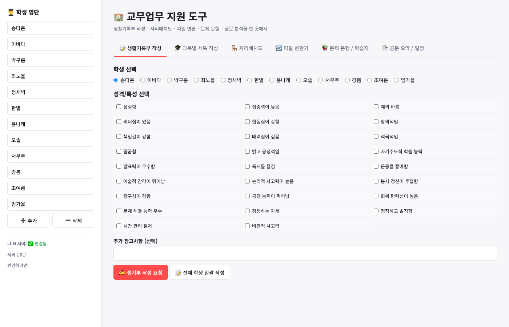
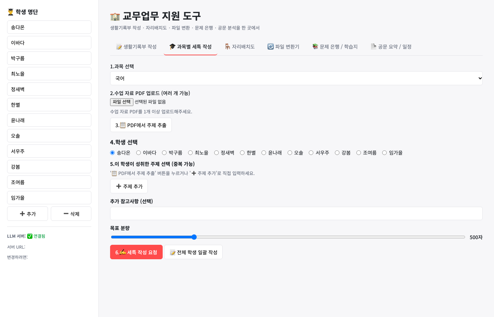
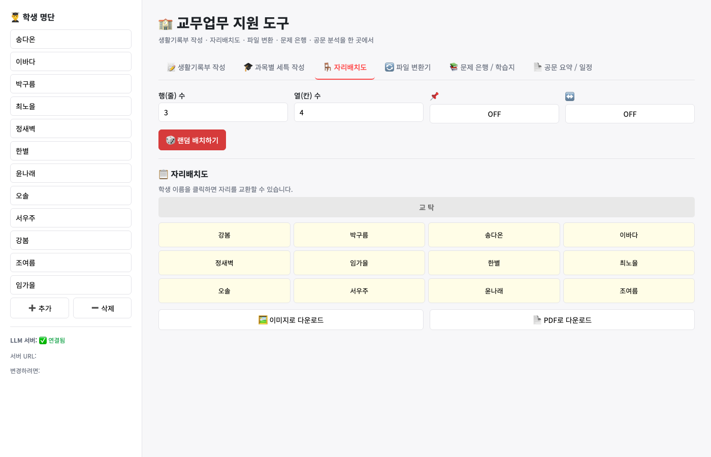

# 교무업무 지원 도구

선생님의 반복 업무를 덜어주는 웹 도구다. 학생 명단을 넣어 두면 생활기록부·세특 문장을 AI가
초안으로 써 주고, 자리배치도, 파일 변환, 문제 출제, 공문 요약까지 한 화면에서 처리한다.
AI는 Gemini를 쓰고, 사용량이 모두 소진되면 DeepSeek(NVIDIA NIM)로 자동 전환된다.

## 기능

화면 왼쪽 사이드바에 학생 명단을 입력한 뒤 위쪽 탭을 골라 쓴다.

- 📝 생활기록부 작성: 학생과 성격·특성을 고르면 생기부 문체로 초안을 쓴다
- 🎓 과목별 세특 작성: 수업 자료 PDF에서 주제를 뽑고, 학생이 성취한 주제로 세특을 쓴다
- 🪑 자리배치도: 행·열을 정해 자리를 섞는다. 자리 고정, 멀리 떨어뜨리기 설정 가능
- 🔄 파일 변환기: 이미지 → PDF, PDF → 이미지, 여러 PDF 합치기
- 📚 문제 은행 / 학습지: 교재 PDF를 올리면 문제를 만든다
- 📄 공문 요약 / 일정: 공문 PDF나 텍스트를 요약하고 일정을 뽑는다

## 화면

생활기록부 작성



과목별 세특 작성



자리배치도



## 설정

키는 코드에 넣지 않는다. 로컬에서는 프로젝트 폴더의 `.env` 파일에, 배포에서는
`npx wrangler@4 secret put <이름>`으로 넣는다. `.env`는 git에 올라가지 않는다.

```bash
GEMINI_API_KEYS=키1,키2          # 쉼표로 여러 개. 한 키가 소진되면 다음 키로 넘어간다
GEMINI_MODELS=gemini-2.5-flash   # 쉼표로 여러 개. 앞에 있는 모델부터 쓴다
NVIDIA_NIM_API_KEY=nvapi-...     # Gemini가 모두 소진됐을 때 쓰는 DeepSeek 키
ACCESS_CODE=암호                 # 설정하면 AI 기능을 쓸 때 접속 암호를 묻는다(선택)
```

## 로컬 실행

```bash
npx wrangler@4 dev
```

브라우저에서 `http://localhost:8787/` 을 연다.

예전 파이썬 서버(`server.py`)도 같은 기능으로 동작한다.

```bash
pip install -r requirements.txt
uvicorn server:app --port 8000
```

이 경우 `http://localhost:8000/` 을 연다. `index.html`을 파일로 직접 열면 AI 기능이 동작하지 않는다.

## 배포

Cloudflare Workers에 올라가 있다(`https://help-v2.bus-relay.workers.dev`).

```bash
npx wrangler@4 deploy
```
